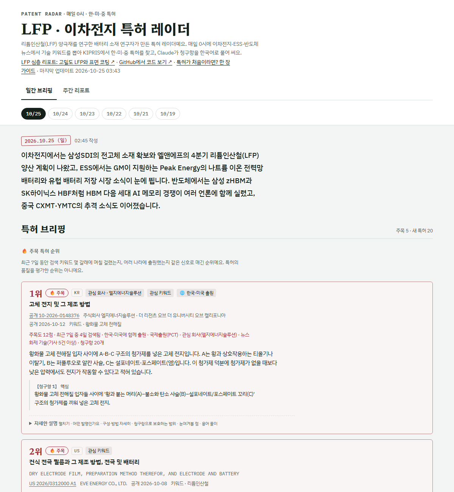
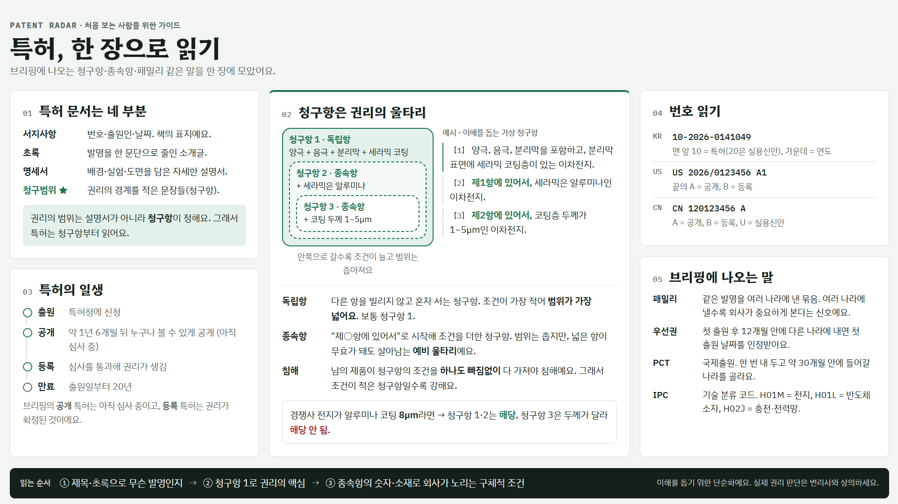
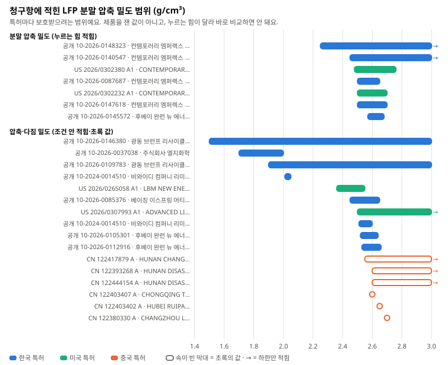
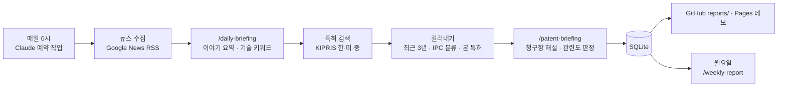

# Patent Radar — LFP · 이차전지 특허 레이더

[](https://github.com/ChoJiwon00/patent-radar/actions/workflows/tests.yml)

리튬인산철(LFP) 양극재를 연구한 배터리 소재 연구자가 만든 특허 레이더예요. 매일 0시에 이차전지·ESS(에너지저장장치)·반도체 뉴스에서
기술 키워드를 뽑아 **한국·미국·중국 특허**를 찾고, Claude가 **청구항을 한국어로 풀어 써요.**

**먼저 볼 것: [LFP 심층 리포트 · 고밀도 LFP와 표면 코팅 (2026년 10월)](reports/deep/high-density-lfp-2026-10.md)**
한·미·중 특허 371건을 모아 주제에 맞는 261건을 추리고, 청구항에 나온 숫자를 원문과 대조해 정리했어요.

- 청구한 LFP 분말 압축 밀도는 2.45–2.76 g/cm³ 구간에 많이 걸쳐 있어요(압연·펠렛 밀도처럼 재는 방법이 다른 7개를 뺀 청구값 14개 중 10개, 하한만 적은 2개 포함). 재는 압력이 특허마다 달라 숫자끼리 바로 비교하면 안 된다는 점도 함께 적었어요.
- 청구항까지 읽은 한·미 특허 59건 가운데 탄소 코팅과 밀도 수치를 한 청구항 묶음에 함께 넣은 특허는 16건이고, 그중 13건이 CATL과 LG화학 출원이에요.
- 1차 소결 때는 탄소를 아주 적게 두고 2차 소결에서 코팅을 채우는 '2단 탄소' 방식이 4건에 보여요.

**두 번째 리포트: [LFP 양산 공정 (2026년 10월)](reports/deep/lfp-process-2026-10.md)**
원료(전구체) → 습식 분쇄 → 분무건조 → 소성 → 분쇄·분급·이물 제거까지, 리튬인산철 가루를 공장에서 만드는 순서대로 특허를 읽었어요(모은 282건 중 범위 안 174건).

- 원료 단계의 공통 관리 숫자는 철-인 비(Fe/P)이고, 새 원료든 재활용 원료든 이 비율을 다시 맞추는 단계가 청구항·초록에 들어 있어요.
- 소성은 낮은 온도와 높은 온도에서 나눠 머무는 2단 소성과, 구간마다 기체를 바꾸는 특허가 반복돼요.
- 청구항이 있는 32건 가운데 17건이 습식 분쇄·분무건조·소성을 함께 적었지만, 분급·체질(4건)·자성 이물(2건) 같은 마무리 품질 조건은 드물었어요.

**청구항 숫자 지도: [그래프로 보기](https://chojiwon00.github.io/patent-radar/claims.html)**
두 리포트에 나온 숫자 140개(밀도·입자 크기·탄소 함량·코팅 두께·소성 온도·분무건조 온도·철-인 비)를 특허마다 범위 막대로 그렸어요. [아래 그림](#청구항-숫자-지도)이 그중 분말 압축 밀도예요.

**데모 사이트:** https://chojiwon00.github.io/patent-radar/ · [주간 리포트](https://chojiwon00.github.io/patent-radar/#weekly)
· 매일 쌓이는 보고서: [`reports/`](reports/)
· [청구항 숫자 지도](https://chojiwon00.github.io/patent-radar/claims.html)
· 특허가 처음이라면: [한 장 가이드](https://chojiwon00.github.io/patent-radar/guide.html)

[](https://chojiwon00.github.io/patent-radar/)

위 그림은 2026년 10월 25일 화면이에요. 브리핑은 매일 0시에 새로 올라오니, 최신 화면은 [데모 사이트](https://chojiwon00.github.io/patent-radar/)에서 보세요(그림을 눌러도 가요).

## 무엇을 하나요

- **특허 브리핑**: 뉴스 키워드와 고정 관심 키워드(리튬인산철, 황화물 고체 전해질 등)로 KIPRIS에서 최근 3년 안의 특허를 최신순으로 찾고,
  청구항을 "어떤 발명인지 → 구성 → 보호 범위 → 눈여겨볼 점 → 용어 풀이"로 풀어 써요. 한 번 본 특허는 다시 나오지 않아요.
- **🔥 주목 특허 순위**: 여러 신호로 점수를 매겨, 점수가 높은 특허는 7일 동안 매일 맨 위에 순위와 함께 보여 줘요.
- **주제 심층 리포트**: 기술 주제 하나를 정해 한·미·중 특허를 깊게 모으고(`patents deep`), 여러 AI 에이전트가 주제별로 읽은 뒤
  **다른 에이전트가 인용문과 숫자를 원문과 글자 그대로 대조**해 리포트로 써요. 매일 브리핑의 '본 특허' 기록에는 넣지 않아요.
- **청구항 숫자 지도**: 심층 리포트의 숫자 표를 7가지 주제로 나눠 특허마다 범위 막대로 그려요(`patents claimmap`). 단위를 하나로 맞추고, 같은 숫자는 한 번만 그려요.
- **뉴스 브리핑**: 세 주제의 기사 제목에서 같은 사건을 묶고, 주제마다 중요한 이야기 3~5개를 요약해요.
- **주간 트렌드 리포트**: 매주 월요일, 일주일치 통계(자주 나온 기술·출원인·기술 분류)와 AI의 흐름 분석을 만들어요.
- **관심 회사·관심 특허**: 양극재·전지 회사를 관심 회사로 두고, 페이지에서 ★ 별표한 특허는 등록 여부를 매주 확인해요.

## 특허가 처음이라면

청구항·독립항·종속항, 특허 번호, 패밀리·PCT 같은 말을 한 장에 정리했어요.
[웹에서 보기](https://chojiwon00.github.io/patent-radar/guide.html) · [이미지 내려받기](docs/guide.png) (1920×1080, 발표 자료에 그대로 붙일 수 있어요)

[](https://chojiwon00.github.io/patent-radar/guide.html)

## 청구항 숫자 지도

심층 리포트 두 편의 '청구항에 나온 숫자' 표에서 비교해도 뜻이 있는 7가지(밀도, 입자 크기, 탄소 함량, 코팅 두께, 소성 온도, 분무건조 온도, 철-인 비)를 골라
특허마다 범위 막대로 그렸어요. 페이지에서 막대에 마우스를 올리면 출원인·항목·값·근거가 나오고, 누르면 원문이 열려요.
[그래프 페이지](https://chojiwon00.github.io/patent-radar/claims.html) · 데이터 [`docs/data/claims.json`](docs/data/claims.json) · 코드 [`patent_radar/claimmap.py`](patent_radar/claimmap.py)

[](https://chojiwon00.github.io/patent-radar/claims.html)

- 숫자는 리포트를 쓸 때 원문과 대조했고, 그래프로 옮긴 뒤에도 140개 모두 원래 청구항·초록에서 다시 찾아 확인했어요.
- 꽉 찬 막대는 청구항의 권리 범위, 속이 빈 막대는 초록에 적힌 값(특허가 내세운 결과값 포함)이에요. 시장 제품을 잰 값이 아니고, 재는 조건(누르는 힘 등)도 특허마다 달라요.
- 색은 회사 국적이 아니라 특허를 낸 나라예요(중국 회사가 한국에 낸 특허는 파란색).

## 동작 방식



요약, 관련도 판정, 흐름 분석은 Claude가 **스킬**([`.claude/skills/`](.claude/skills/))에 적힌 기준대로 쓰고,
수집, 검색, 중복 제거, 점수 계산, 검사, 저장, 보고서는 Python 코드가 해요.
AI가 쓴 결과는 항상 코드가 형식을 검사한 뒤에 저장하고, 특허 해설에는 청구항·초록에 있는 내용만 쓰게 해요.

## 🔥 주목 특허는 어떻게 고르나

특허에는 공개된 조회수가 없고, 다른 특허에 인용된 횟수는 몇 년이 지나야 쌓여서 막 나온 특허에는 쓰기 어려워요.
그래서 최근 7일 동안의 검색 결과로 아래 점수를 매기고, 5점 이상인 특허를 순위대로 매일 맨 위에 보여 줘요.
특허의 품질을 평가한 점수가 아니라, 뉴스·관심사와 얼마나 자주 이어졌는지를 보는 점수예요.

| 신호 | 점수 | 뜻 |
|---|---|---|
| 검색 키워드(뉴스·고정 관심) 한 갈래에 걸릴 때마다 | +2 | 여러 기술 주제와 이어진 특허. 다른 키워드를 통째로 품은 키워드(띄어쓰기나 '양극재·양극 활물질' 같은 꼬리말만 다른 것 포함)는 한 갈래로 셈 |
| 검색에 걸린 날 하루마다 (첫날 제외) | +1 | 며칠째 계속 뉴스와 이어지는 기술 |
| 같은 발명을 다른 나라에도 냈으면 나라마다 | +2 | 여러 나라에 비용을 들여 낸 발명 (우선권·국제출원 번호로 확인) |
| 국제출원(PCT) | +1 | 해외 출원을 염두에 둔 발명 |
| 관심 회사의 특허 | +2 | 지켜보는 회사의 움직임 |
| 기사가 많이 나온 이야기의 키워드 | +1 | 뉴스에서 화제가 된 기술 |
| 살아 있는 청구항 20개 이상 | +1 | 권리 범위를 넓게 잡은 특허 (심사 중에 삭제된 항은 빼고 셈) |

AI가 관련도를 낮게 판정한 특허는 순위에서 빠지고 페이지에서는 접혀서 보여요. 순위에 오른 뒤에 판정이 바뀌면 지난 날짜의 순위에서도 빠져요.

## 검색 정확도를 높인 방법

- **특허 분류(IPC) 필터**: 주제마다 맞는 분류(예: 이차전지는 `H01M` 전지, 반도체는 `H10B` 메모리)만 남겨서,
  "배터리 교환 중 화면 표시"처럼 키워드만 겹치는 특허를 걸러요.
- **0건이면 다시 찾기**: 한국 특허는 띄어쓰기·용어가 조금만 달라도 안 잡혀서, AI가 미리 써 둔 다른 표현으로 한 번 더 찾아요.
- **AI 관련도 판정**: 요약을 쓰면서 관련 높음/낮음을 함께 판정하고 이유를 한 줄 남겨요. 검색어와 다른 기술이라도
  고정 관심 키워드(예: 리튬인산철) 기술이면 관련 있음으로 남겨요.

## 기술적으로 신경 쓴 점

- **무료 호출 한도 관리**: KIPRIS 무료 한도(국내·해외 각각 월 1,000회)를 넘지 않게 호출 수를 세고 상한에서 멈춰요.
  상세 정보(청구항)는 브리핑에 넣을 특허만 가져와요.
- **AI 출력 검사**: 브리핑·요약·주간 분석 JSON을 코드가 검사하고, 틀리면 무엇이 틀렸는지 알려 줘서 AI가 고쳐 다시 저장해요.
- **원문 링크**: Google Patents는 막 공개된 미국 특허를 몇 주 동안 찾지 못해서, 미국 특허는 USPTO 원문 PDF로 연결해요.
- **페이지 하나, 데이터 출처 둘**: 같은 HTML이 개인용 claude.ai 페이지에서는 페이지 데이터베이스를, GitHub Pages에서는 `docs/data/*.json`을 읽어요.
- **테스트와 CI**: 실제 KIPRIS 대신 가짜 클라이언트로 검색·점수·검사 로직을 테스트하고, GitHub에 올릴 때마다 자동으로 돌아요.
- **비밀 값 분리**: API 키는 `.env`에만 두고 GitHub에 올리지 않아요.

## 한계

- 특허 해설과 뉴스 요약은 AI가 쓴 것이라 틀린 곳이 있을 수 있고, 법률 자문이 아니에요. 중요한 내용은 원문 링크에서 확인해 주세요.
- 중국 특허는 KIPRIS에 청구항 원문이 없어 초록으로 해설하고, 데이터가 약 3개월 늦게 들어와요.
- 뉴스 요약은 기사 제목만 보고 써요 (기사 본문은 저작권 때문에 가져오지 않아요).
- 매일 0시 실행은 컴퓨터가 켜져 있고 Claude 앱이 열려 있어야 해요. 놓치면 앱을 열 때 실행돼요.

## 폴더 구조

```
patent-radar/
├─ .claude/skills/           AI가 하는 일 (daily-briefing · patent-briefing · weekly-report)
├─ artifact/briefing.html    브리핑 페이지 (claude.ai와 GitHub Pages가 함께 씀)
├─ config/topics.toml        뉴스 주제·검색어·IPC 분류·관심 회사·관심 키워드·특허 검색 설정
├─ config/deep/              주제 심층 리포트의 검색어 설정
├─ docs/                     GitHub Pages 공개 사이트 (index.html + data/, 특허 한 장 가이드 guide.html, 청구항 숫자 지도 claims.html)
├─ reports/                  날짜별 특허 브리핑, 주간 리포트(weekly/), 주제 심층 리포트(deep/)
├─ patent_radar/
│  ├─ __main__.py            명령줄 진입점
│  ├─ news.py                뉴스 수집·중복 제거
│  ├─ briefing.py            AI 뉴스 브리핑 검사·저장
│  ├─ patents.py             KIPRIS 검색, 걸러내기, 주목도 점수, 요약 저장, 보고서
│  ├─ deep.py                주제 심층 리포트용 특허 모으기
│  ├─ claimmap.py            심층 리포트의 숫자 표 → 청구항 숫자 지도 데이터·그림
│  ├─ stars.py               ★ 관심 특허 동기화·진행 상태 확인
│  ├─ weekly.py              주간 통계·AI 분석·보고서
│  ├─ website.py             GitHub Pages 사이트 만들기
│  ├─ db.py · config.py      SQLite 저장소 · 설정
│  └─ web.py · static/       로컬 웹페이지 (뉴스 보기)
└─ tests/                    자동 테스트
```

## 설치와 사용

Python 3.11 이상이 필요해요(자동 테스트는 3.13에서 돌려요). 아래 명령은 Windows PowerShell 기준이에요.

```powershell
python -m venv .venv
.venv\Scripts\python -m pip install -r requirements.txt
copy .env.example .env
```

`.env` 파일을 열어 `KIPRIS_API_KEY=` 뒤에 KIPRIS Plus 인증키를 붙여 넣어요.

```powershell
# 뉴스 수집 / 특허 검색 / 사용량
.venv\Scripts\python -m patent_radar news
.venv\Scripts\python -m patent_radar patents search
.venv\Scripts\python -m patent_radar patents usage

# 공개 사이트 만들기 (docs/)
.venv\Scripts\python -m patent_radar site export
# 청구항 숫자 지도 데이터 다시 만들기 (심층 리포트를 고쳤을 때만, KIPRIS를 부르지 않아요)
.venv\Scripts\python -m patent_radar patents claimmap

# 테스트
.venv\Scripts\python -m pytest
```

Claude Code에서는 `/daily-briefing`, `/patent-briefing`(또는 `/patent-briefing 전고체 전해질`), `/weekly-report`로 실행해요.

## 데이터 출처

- 뉴스: [Google News RSS](https://news.google.com) 검색 피드 (제목·언론사·링크만 사용)
- 특허: [KIPRIS Plus](https://plus.kipris.or.kr) Open API (한국 특허, 해외특허)
- 원문 링크: 한국 특허는 KIPRIS, 미국 특허는 [USPTO](https://ppubs.uspto.gov), 중국 특허는 [Google Patents](https://patents.google.com)

## 기술 스택

Python 3.13 · SQLite · httpx · FastAPI · HTML/CSS/JavaScript · Claude Code (스킬·예약 작업) · GitHub Actions · GitHub Pages
