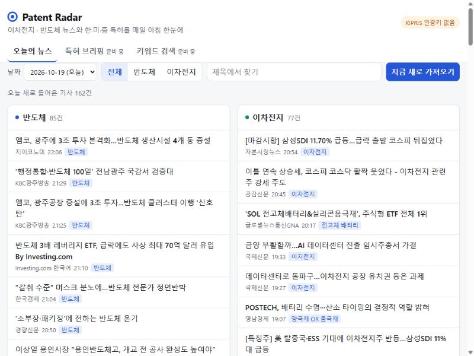

# Patent Radar

이차전지·반도체 분야의 **최신 뉴스**를 매일 아침 모으고, 뉴스에서 뽑은 기술 키워드로
**한국·미국·중국 특허**를 찾아 **AI가 한국어로 요약**해 주는 개인용 특허 레이더입니다.



## 기능

| 기능 | 상태 |
|---|---|
| 이차전지·반도체 뉴스 자동 수집 (Google News RSS) | ✅ 완료 |
| 이미 본 기사 다시 안 보이기 (같은 링크·비슷한 제목 제거) | ✅ 완료 |
| 웹페이지에서 날짜·주제·제목으로 뉴스 보기 | ✅ 완료 |
| AI 뉴스 브리핑: 주요 이야기 요약 + 특허 검색 키워드 (`/daily-briefing` 스킬) | ✅ 완료 |
| 매일 오전 9시 자동 브리핑 (Claude 예약 작업) | ✅ 완료 |
| 한국 특허 검색 (KIPRIS Plus) | ⏳ 인증키 발급 대기 |
| 미국·중국 특허 검색 (KIPRIS Plus 해외특허) | ⏳ 예정 |
| 한 번 본 특허 숨기기, 크게 뜨는 특허 🔥 강조 | ⏳ 예정 |
| 청구항 AI 요약과 한국어 번역 | ⏳ 예정 |
| 키워드로 특허 직접 검색 | ⏳ 예정 |

## 동작 방식

```
매일 09:00 ─▶ 뉴스 수집 ─▶ 기술 키워드 추출 ─▶ 한·미·중 특허 검색(최신순)
                                            │
             웹페이지 ◀─ 한국어 요약·번역 ◀─ 본 특허 제외 / 🔥 강조
```

## AI 브리핑은 어떻게 만들어지나

AI가 하는 일은 [Claude Code](https://claude.com/claude-code) 스킬([`.claude/skills/daily-briefing/SKILL.md`](.claude/skills/daily-briefing/SKILL.md))에 적혀 있습니다.

1. `python -m patent_radar news --json`으로 오늘의 새 기사를 받는다.
2. 같은 사건을 다룬 기사를 묶고, 주제별로 중요한 이야기 3~5개를 골라 요약한다.
3. 특허 청구항에 나올 만한 기술 용어를 한국어·영어 짝으로 뽑는다.
4. `python -m patent_radar briefing save`로 형식을 검사한 뒤 저장한다.

Claude Code에서 `/daily-briefing`을 입력하면 바로 실행되고, 예약 작업으로 매일 오전 9시에 자동 실행됩니다.

## 폴더 구조

```
patent-radar/
├─ .claude/skills/daily-briefing/   AI 브리핑 스킬
├─ config/topics.toml        뉴스 주제·검색어·제외할 출처 (자유롭게 수정)
├─ patent_radar/
│  ├─ __main__.py            명령줄 진입점
│  ├─ config.py              경로, .env, 설정 읽기
│  ├─ db.py                  SQLite 저장소 (data/radar.db)
│  ├─ news.py                뉴스 수집·중복 제거
│  ├─ briefing.py            AI 브리핑 검사·저장·조회
│  ├─ web.py                 웹 서버와 API
│  └─ static/                웹페이지 (HTML·CSS·JS)
├─ tests/                    자동 테스트
├─ .env.example              API 키 양식 (.env는 GitHub에 올라가지 않음)
└─ requirements.txt
```

## 설치

Python 3.11 이상이 필요합니다.

```bash
python -m venv .venv
.venv\Scripts\python -m pip install -r requirements.txt
copy .env.example .env
```

`.env` 파일을 열어 `KIPRIS_API_KEY=` 뒤에 KIPRIS Plus 인증키를 붙여 넣습니다.

## 사용법

```bash
# 뉴스 수집
.venv\Scripts\python -m patent_radar news

# 저장된 AI 브리핑 보기
.venv\Scripts\python -m patent_radar briefing show

# 웹페이지 실행 → 브라우저에서 http://127.0.0.1:8000
.venv\Scripts\python -m patent_radar serve

# 테스트
.venv\Scripts\python -m pytest
```

## 데이터 출처

- 뉴스: [Google News RSS](https://news.google.com) 검색 피드
- 한국·해외 특허: [KIPRIS Plus](https://plus.kipris.or.kr) Open API (무료 월 1,000건)

## 기술 스택

Python 3.13 · FastAPI · SQLite · HTML/CSS/JavaScript · Claude Code
