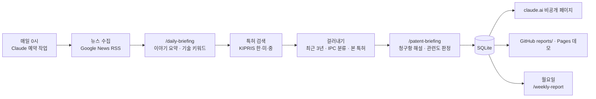

# Patent Radar

[](https://github.com/ChoJiwon00/patent-radar/actions/workflows/tests.yml)

이차전지·ESS(에너지저장장치)·반도체 분야의 **최신 뉴스**를 매일 0시에 모으고, 뉴스에서 뽑은 기술 키워드로
**한국·미국·중국 특허**를 찾아 **AI가 청구항을 한국어로 요약·해설**해 주는 개인용 특허 레이더입니다.

**데모:** https://chojiwon00.github.io/patent-radar/ · 주간 리포트: https://chojiwon00.github.io/patent-radar/#weekly
· 매일 쌓이는 보고서: [`reports/`](reports/)
· 특허가 처음이라면: [한 장 가이드](https://chojiwon00.github.io/patent-radar/guide.html)
· 주제 심층 리포트: [고밀도 LFP와 표면 코팅 (2026년 10월)](reports/deep/high-density-lfp-2026-10.md)

[](https://chojiwon00.github.io/patent-radar/)

위 그림은 2026년 10월 21일에 찍은 화면이에요. 브리핑은 매일 0시에 새로 올라오니, 최신 화면은 [데모 사이트](https://chojiwon00.github.io/patent-radar/)에서 보세요(그림을 눌러도 가요).

## 무엇을 하나요

- **뉴스 브리핑**: 세 주제의 기사 수백 건에서 같은 사건을 묶고, 주제마다 중요한 이야기 3~5개를 요약해요.
- **특허 브리핑**: 뉴스에서 뽑은 기술 키워드로 KIPRIS에서 최근 3년 안의 특허를 최신순으로 찾고, 청구항을
  "어떤 발명인지 → 구성 → 보호 범위 → 눈여겨볼 점 → 용어 풀이"로 풀어 써요. 한 번 본 특허는 다시 나오지 않아요.
- **🔥 주목 특허 순위**: 여러 신호로 점수를 매겨, 뜨는 특허는 7일 동안 매일 맨 위에 순위와 함께 보여 줘요.
- **주간 트렌드 리포트**: 매주 월요일, 일주일치 통계(자주 나온 기술·출원인·기술 분류)와 AI의 흐름 분석을 만들어요.
- **주제 심층 리포트**: 기술 주제 하나를 정해 한·미·중 특허를 깊게 모으고(`patents deep`), 여러 AI 에이전트가 주제별로 읽은 뒤
  **다른 에이전트가 인용문과 숫자를 원문과 글자 그대로 대조**해 리포트로 써요. 매일 브리핑의 '본 특허' 기록에는 넣지 않아요.
  첫 리포트: [고밀도 LFP와 표면 코팅](reports/deep/high-density-lfp-2026-10.md) (주제에 맞는 261건, 본문 인용 86건).
- **내 관심사**: 관심 회사·고정 관심 키워드를 설정하고, 페이지에서 ★ 별표한 특허는 등록 여부를 매주 확인해요.
- **어디서나 보기**: claude.ai 사이드바에 고정한 비공개 페이지, 공개 데모 사이트(GitHub Pages), Markdown 보고서.

## 특허가 처음이라면

청구항·독립항·종속항, 특허 번호, 패밀리·PCT 같은 말을 한 장에 정리했어요.
[웹에서 보기](https://chojiwon00.github.io/patent-radar/guide.html) · [이미지 내려받기](docs/guide.png) (1920×1080, 발표 자료에 그대로 붙일 수 있어요)

[](https://chojiwon00.github.io/patent-radar/guide.html)

## 동작 방식



사람이 판단해야 하는 일(요약, 관련도 판정, 흐름 분석)은 Claude가 **스킬**([`.claude/skills/`](.claude/skills/))에 적힌
순서대로 하고, 나머지(수집, 검색, 중복 제거, 점수 계산, 검사, 저장, 보고서)는 Python 코드가 해요.
AI가 쓴 결과는 항상 코드가 형식을 검사한 뒤에 저장해요.

## 🔥 주목 특허는 어떻게 고르나

특허에는 공개된 조회수가 없고, 다른 특허에 인용된 횟수는 몇 년이 지나야 쌓여서 막 나온 특허에는 쓰기 어려워요.
그래서 최근 7일 동안의 검색 결과로 아래 점수를 매기고, 5점 이상인 특허를 순위대로 매일 맨 위에 보여 줘요.

| 신호 | 점수 | 뜻 |
|---|---|---|
| 뉴스 키워드 하나에 걸릴 때마다 | +2 | 여러 뉴스 주제와 이어진 기술 |
| 검색에 걸린 날 하루마다 (첫날 제외) | +1 | 며칠째 계속 뉴스와 이어지는 기술 |
| 같은 발명을 다른 나라에도 냈으면 나라마다 | +2 | 여러 나라에 비용을 들여 낸 발명 (우선권·국제출원 번호로 확인) |
| 국제출원(PCT) | +1 | 해외 출원을 염두에 둔 발명 |
| 관심 회사의 특허 | +2 | 지켜보는 회사의 움직임 |
| 기사가 많이 나온 이야기의 키워드 | +1 | 뉴스에서 화제가 된 기술 |
| 청구항 20개 이상 | +1 | 권리 범위를 넓게 잡은 특허 |

AI가 "오늘 주제와 관련 낮음"으로 판정한 특허는 순위에서 빠지고, 페이지에서는 접혀서 보여요.

## 검색 정확도를 높인 방법

- **특허 분류(IPC) 필터**: 주제마다 맞는 분류(예: 이차전지는 `H01M` 전지, 반도체는 `H10B` 메모리)만 남겨서,
  "배터리 교환 중 화면 표시"처럼 키워드만 겹치는 특허를 걸러요.
- **0건이면 다시 찾기**: 한국 특허는 띄어쓰기·용어가 조금만 달라도 안 잡혀서, AI가 미리 써 둔 다른 표현으로 한 번 더 찾아요.
- **AI 관련도 판정**: 요약을 쓰면서 관련 높음/낮음을 함께 판정하고 이유를 한 줄 남겨요.

## 기술적으로 신경 쓴 점

- **무료 호출 한도 관리**: KIPRIS 무료 한도(국내·해외 각각 월 1,000회)를 넘지 않게 호출 수를 세고 상한에서 멈춰요.
  상세 정보(청구항)는 브리핑에 넣을 특허만 가져와요.
- **AI 출력 검사**: 브리핑·요약·주간 분석 JSON을 코드가 검사하고, 틀리면 무엇이 틀렸는지 알려 줘서 AI가 고쳐 다시 저장해요.
- **페이지 하나, 데이터 출처 둘**: 같은 HTML이 claude.ai에서는 페이지 데이터베이스를, GitHub Pages에서는 `docs/data/*.json`을 읽어요.
- **테스트와 CI**: 실제 KIPRIS 대신 가짜 클라이언트로 검색·점수·검사 로직을 테스트하고, GitHub에 올릴 때마다 자동으로 돌아요.
- **비밀 값 분리**: API 키는 `.env`에만 두고 GitHub에 올리지 않아요.

## 한계

- 중국 특허는 KIPRIS에 청구항 원문이 없어 초록으로 해설하고, 데이터가 약 3개월 늦게 들어와요.
- 뉴스 요약은 기사 제목만 보고 써요 (기사 본문은 저작권 때문에 가져오지 않아요).
- 매일 0시 실행은 컴퓨터가 켜져 있고 Claude 앱이 열려 있어야 해요. 놓치면 앱을 열 때 실행돼요.

## 폴더 구조

```
patent-radar/
├─ .claude/skills/           AI가 하는 일 (daily-briefing · patent-briefing · weekly-report)
├─ artifact/briefing.html    브리핑 페이지 (claude.ai와 GitHub Pages가 함께 씀)
├─ config/topics.toml        뉴스 주제·검색어·IPC 분류·관심 회사·관심 키워드·특허 검색 설정
├─ docs/                     GitHub Pages 공개 사이트 (index.html + data/, 특허 한 장 가이드 guide.html)
├─ reports/                  날짜별 특허 브리핑과 주간 리포트 (Markdown)
├─ patent_radar/
│  ├─ __main__.py            명령줄 진입점
│  ├─ news.py                뉴스 수집·중복 제거
│  ├─ briefing.py            AI 뉴스 브리핑 검사·저장
│  ├─ patents.py             KIPRIS 검색, 걸러내기, 주목도 점수, 요약 저장, 보고서
│  ├─ stars.py               ★ 관심 특허 동기화·진행 상태 확인
│  ├─ weekly.py              주간 통계·AI 분석·보고서
│  ├─ website.py             GitHub Pages 사이트 만들기
│  ├─ db.py · config.py      SQLite 저장소 · 설정
│  └─ web.py · static/       로컬 웹페이지 (뉴스 보기)
└─ tests/                    자동 테스트
```

## 설치와 사용

Python 3.11 이상이 필요해요.

```bash
python -m venv .venv
.venv\Scripts\python -m pip install -r requirements.txt
copy .env.example .env
```

`.env` 파일을 열어 `KIPRIS_API_KEY=` 뒤에 KIPRIS Plus 인증키를 붙여 넣어요.

```bash
# 뉴스 수집 / 특허 검색 / 사용량
.venv\Scripts\python -m patent_radar news
.venv\Scripts\python -m patent_radar patents search
.venv\Scripts\python -m patent_radar patents usage

# 공개 사이트 만들기 (docs/)
.venv\Scripts\python -m patent_radar site export

# 테스트
.venv\Scripts\python -m pytest
```

Claude Code에서는 `/daily-briefing`, `/patent-briefing`(또는 `/patent-briefing 전고체 전해질`), `/weekly-report`로 실행해요.

## 데이터 출처

- 뉴스: [Google News RSS](https://news.google.com) 검색 피드 (제목·언론사·링크만 사용)
- 특허: [KIPRIS Plus](https://plus.kipris.or.kr) Open API (한국 특허, 해외특허)

## 기술 스택

Python 3.13 · SQLite · httpx · FastAPI · HTML/CSS/JavaScript · Claude Code (스킬·예약 작업) · GitHub Actions · GitHub Pages
